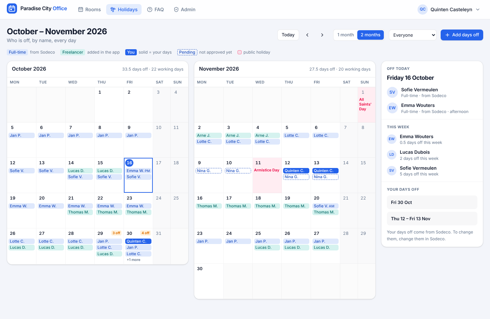
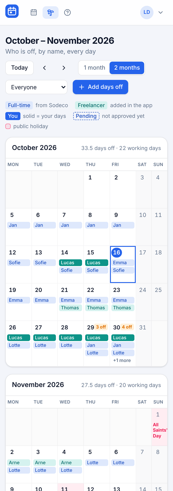
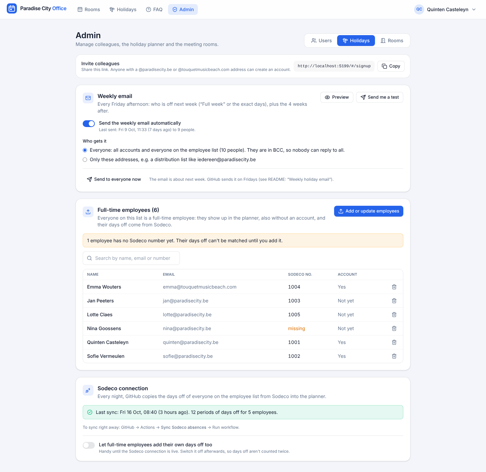
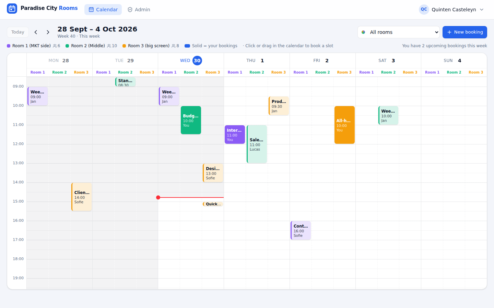
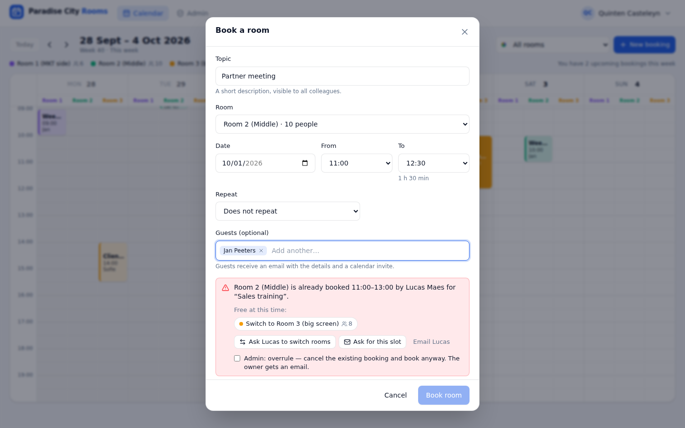
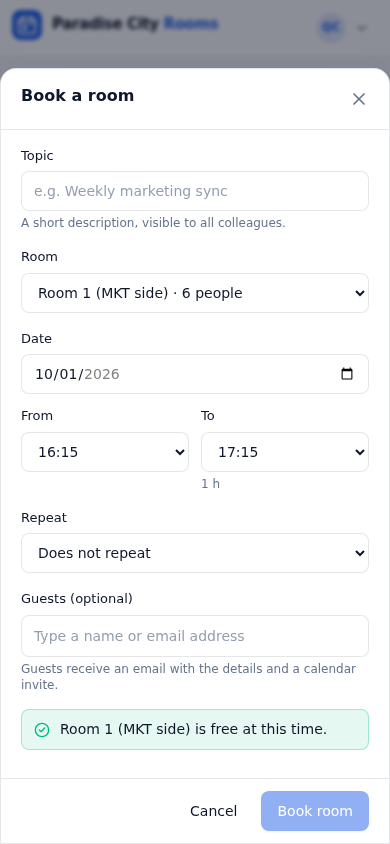

# Paradise City Office

One place for the Paradise City office: **book the meeting rooms** and see **who is off** in the holiday planner.

**What colleagues can do**

*Meeting rooms*

- See the **current week** (Monday–Friday, 07:00–20:00) right away, then browse with ◀ ▶ and jump back with **Today**. On Saturday and Sunday it opens on next week.
- Filter with the dropdown: **All rooms** side by side, or one room at a time.
- **Click or drag** in the calendar to book a slot, in 15-minute steps up to a full day, at most 3 months ahead.
- See who booked what, and for which topic.
- Set up **recurring bookings**: every weekday, weekly, every 2 weeks, or monthly. Dates that are already taken are skipped or put on the waiting list.
- Join the **waiting list** for a taken slot. When that booking is cancelled or moved, the first person waiting gets the room automatically and an email.
- Add **guests**. They receive an email with the details and a calendar file for Outlook.
- Handle a **conflict** in a few clicks. The app shows which rooms are free, or you can use the buttons *Ask to switch rooms*, *Ask for this slot* and *Email the organiser*. Each button opens a ready-to-send email in your own mail app.

*Holiday planner*

- See **who is off, by name, on every day**, one or two months at a time. On a phone the months are shown below each other.
- Everyone is in one calendar: **full-time employees** (their days off come in automatically from **Sodeco** every night) and **freelancers** (they add their own days off in the app, also half days).
- Public holidays in Belgium are marked. Days when a quarter of the team is off get an amber “n off” badge.
- Click a day to see everyone who is off, who is off this week, and your own days off.
- **Every Friday** everyone gets an email: who is off next week (“Full week” or the exact days), plus who has days off planned in the 4 weeks after.
- Colleagues only see *that* someone is off, never why. Leave types, sick leave and balances stay in Sodeco.

*Account*

- Create an account with their **@paradisecity.be** or **@touquetmusicbeach.com** address (with email confirmation), and say whether they are a **full-time employee or a freelancer**. Colleagues who already had an account are asked once, the first time they sign in.
- Reset a forgotten password by email.
- Pick their own **colours** for the background and buttons. The choice is saved on their account and only affects them.
- Find answers in the **FAQ**, including “How do I change my status? Ask one of the admins”, with the admins' email addresses.

**What admins (quinten@paradisecity.be and whoever they make admin) can do**

- Change or cancel any booking, or **overrule** it when booking. The original owner gets an email.
- Rename rooms and change their capacity and colour.
- Block, unblock or delete colleagues, give other colleagues admin rights, and change anyone's **work status** (full-time employee or freelancer).
- Keep the **list of full-time employees** with their Sodeco numbers (paste it from Excel). Everyone on it shows up in the planner, also without an account.
- Add, change or remove days off for anyone (except the ones that come from Sodeco).
- Preview the weekly email, send themselves a test, send it right away, switch it off, or send it to a distribution list instead of to everyone.
- See when Sodeco last synced and whether it worked.

| Holiday planner | Phone | Admin → Holidays |
|---|---|---|
|  |  |  |
| **Room calendar** | **Booking with conflict help** | **Rooms on a phone** |
|  |  |  |

<sub>Screenshots use made-up colleagues, bookings and days off.</sub>

**How it's built:** a React website hosted on **GitHub Pages**, with login, the database and email functions on **Supabase**. Emails are sent through your **Microsoft 365** account. Two scheduled **GitHub Actions** copy the days off from Sodeco every night and send the weekly email on Fridays. The database enforces every rule (no double bookings, who may add days off for whom, and so on), so nobody can get around them.

---

## Already using the room booker? Add the holiday planner (about 20 minutes)

If the room booker is already live, you only need these steps. Each one is explained in full further down.

1. **Database:** run [`supabase/migrations/20261016000000_holiday_planner.sql`](supabase/migrations/20261016000000_holiday_planner.sql) once in the Supabase SQL Editor ([step 2](#2-create-the-database)).
2. **Code:** merge this branch into `main`. GitHub then publishes the new website and deploys the new `holiday-digest` function by itself. Check that both **Deploy website** and **Deploy Supabase functions** turn green in the **Actions** tab. If the functions one didn't run, start it with **Run workflow** ([step 5](#5-deploy-the-email-and-admin-functions)).
3. **Weekly email:** create the `CRON_SECRET` and add it to both Supabase and GitHub ([step 9](#9-the-weekly-holiday-email)).
4. **Employee list:** paste the full-time employees into **Admin → Holidays** ([step 10](#10-fill-in-the-employee-list)).
5. **Sodeco:** when Sodeco has sent the certificate, connect it ([step 11](#11-connect-sodeco)). Until then you can let full-time employees add their own days off (Admin → Holidays → *Sodeco connection*).

Everyone who already has an account gets the question “Full-time employee or freelancer?” the next time they sign in. People on the employee list are set to full-time automatically.

---

## One-time setup from scratch (about 60 minutes)

You need to be an admin in GitHub, Supabase and Microsoft 365 (Entra ID). Do the steps in this order.

### 1. Create the Supabase project

1. Go to [supabase.com](https://supabase.com) → **New project**.
2. Name: `paradise-city-office`. Region: **Central EU (Frankfurt)**. Choose a strong database password and store it safely.
3. Wait until the project is ready.

### 2. Create the database

1. In Supabase, open **SQL Editor** → **New query**.
2. Open [`supabase/migrations/20260930000000_init.sql`](supabase/migrations/20260930000000_init.sql) in GitHub, copy **all** of it and paste it into the editor.
3. Click **Run**. You should see *Success. No rows returned*.

This creates the three rooms (Room 1 (MKT side) · 6 people, Room 2 (Middle) · 10, Room 3 (big screen) · 8) and all the rules.

Then run the other files in `supabase/migrations/` the same way, **in date order, each one once**:

| File | What it adds |
|---|---|
| `20261006000000_second_email_domain.sql` | `@touquetmusicbeach.com` addresses can sign up too |
| `20261007000000_waiting_list_weekdays.sql` | waiting list, Monday to Friday only |
| `20261016000000_holiday_planner.sql` | the holiday planner: work status, employee list, days off, weekly email settings |

> Tip: to check what's already been run, open **Table Editor**. If you see the tables `staff`, `absences` and `app_settings`, the holiday planner file has been run.

### 3. Connect the website and publish it on GitHub Pages

1. In Supabase, open **Project Settings → API Keys** (or **API**) and copy:
   - the **Project URL**, e.g. `https://abcdefgh.supabase.co`. The part before `.supabase.co` is your *project ref*.
   - the **anon / publishable** key. This key is meant to be public, and the database rules protect the data.
2. In GitHub, open this repository → **Settings → Secrets and variables → Actions → Variables** tab → **New repository variable**, and add:

   | Name | Value |
   |---|---|
   | `SUPABASE_URL` | the Project URL |
   | `SUPABASE_ANON_KEY` | the anon / publishable key |
   | `SUPABASE_PROJECT_REF` | the project ref (e.g. `abcdefgh`) |

3. **Settings → Pages** → *Build and deployment* → Source: **GitHub Actions**.
   (GitHub Pages on a *private* repository needs a paid GitHub plan.)
4. Merge this code into the `main` branch. The **Deploy website** action runs automatically (see the **Actions** tab).
   Your site will be at **`https://quintencasteleyn.github.io/meetingroombookerparadisecityoffice/`**. This address is called `APP_URL` below.

### 4. Let the app send email from Microsoft 365

The app sends all emails (account confirmation, password reset, guest invitations, admin notices, the weekly holiday email) from one mailbox through Microsoft Graph.

1. **Create the sender mailbox.** In the Microsoft 365 admin center → *Teams & groups → Shared mailboxes*, create e.g. **rooms@paradisecity.be**. A shared mailbox needs no licence.
2. **Register the app.** In [entra.microsoft.com](https://entra.microsoft.com) → *App registrations* → **New registration**:
   - Name: `Paradise City Office`, *Accounts in this organizational directory only*, no redirect URI.
   - Copy the **Application (client) ID** and the **Directory (tenant) ID** from the overview page.
3. **API permissions** → *Add a permission* → **Microsoft Graph** → **Application permissions** → **Mail.Send** → Add, then click **Grant admin consent**.
4. **Certificates & secrets** → *New client secret* (e.g. 24 months) → copy the **Value** straight away. Put a reminder in your calendar to renew it before it expires.
5. *(Recommended)* Limit the app so it can only send as `rooms@paradisecity.be` and not as any mailbox. Microsoft calls this *RBAC for Applications* (older name: *Application Access Policy*), and you set it up in Exchange Online PowerShell.

### 5. Deploy the email and admin functions

1. Create a Supabase access token: [supabase.com/dashboard/account/tokens](https://supabase.com/dashboard/account/tokens) → *Generate new token*.
2. GitHub → **Settings → Secrets and variables → Actions → Secrets** tab → **New repository secret**: `SUPABASE_ACCESS_TOKEN` = that token.
3. GitHub → **Actions** → **Deploy Supabase functions** → **Run workflow**. When it's green, Supabase lists 4 functions under **Edge Functions**: `notify`, `admin-users`, `auth-email` and `holiday-digest`.

### 6. Give the functions their settings

Supabase → **Edge Functions → Secrets** (or *Project Settings → Edge Functions*) → add:

| Name | Value |
|---|---|
| `MS_TENANT_ID` | Directory (tenant) ID from step 4 |
| `MS_CLIENT_ID` | Application (client) ID from step 4 |
| `MS_CLIENT_SECRET` | the client secret **Value** from step 4 |
| `MAIL_FROM` | `rooms@paradisecity.be` |
| `APP_URL` | `https://quintencasteleyn.github.io/meetingroombookerparadisecityoffice/` |
| `CRON_SECRET` | see [step 9](#9-the-weekly-holiday-email) |

### 7. Configure login and emails in Supabase

1. **Authentication → URL Configuration**
   - Site URL: your `APP_URL`
   - Redirect URLs: add your `APP_URL` followed by `**`
2. **Authentication → Sign In / Providers → Email**
   - *Confirm email*: **on**
   - Minimum password length: **8**
3. **Authentication → Hooks** (or *Auth Hooks*) → **Send Email hook** → enable:
   - Type: **HTTPS**
   - URL: `https://<project-ref>.supabase.co/functions/v1/auth-email`
   - Click **Generate secret**, copy it (it starts with `v1,whsec_`) and **save** the hook.
   - Go back to **Edge Functions → Secrets** and add `SEND_EMAIL_HOOK_SECRET` = that secret.

From now on, Supabase sends confirmation and password-reset emails through your Microsoft 365 mailbox instead of its own limited mailer.

### 8. First sign-in

1. Open the website → **Create an account** with **quinten@paradisecity.be** and choose *Full-time employee*. That account automatically becomes admin.
2. Confirm your email with the link you receive, then sign in.
3. Go to **Admin** → copy the sign-up link and share it with the team.

### 9. The weekly holiday email

Every Friday afternoon (15:00 Brussels time in summer, 14:00 in winter, because GitHub runs on UTC) GitHub asks the `holiday-digest` function to send the email about next week. A shared password, the `CRON_SECRET`, makes sure nobody else can trigger it.

1. **Make up a long random password** (at least 32 characters, letters and digits only), for example with your password manager. This is the `CRON_SECRET`. You don't need to remember it.
2. **Supabase** → **Edge Functions → Secrets** → **Add new secret**: name `CRON_SECRET`, value = that password → **Save**.
3. **GitHub** → this repository → **Settings → Secrets and variables → Actions** → **Secrets** tab → **New repository secret**: name `CRON_SECRET`, value = the **same** password → **Add secret**.
4. **Test it from the app:** sign in → **Admin → Holidays** → *Weekly email* → **Preview** (shows the email on screen) and **Send me a test** (sends it only to you).
5. **Test the schedule:** GitHub → **Actions** → **Weekly holiday email** → **Run workflow**. This really sends the email to everyone (for next week), so do it when you're ready. Running it a second time in the same week does nothing: each week is sent only once.

Who gets it: by default **everyone** (all accounts plus everyone on the employee list), in BCC. In **Admin → Holidays** you can switch to a distribution list (e.g. `iedereen@paradisecity.be`) or switch the email off.

### 10. Fill in the employee list

The employee list says who the full-time employees are, and which Sodeco number belongs to which email address.

1. Make a list in Excel with three columns: **work email**, **full name**, **Sodeco worker number** (in Prisma: the *personeelsnummer* / worker number).
2. In the app: **Admin → Holidays** → *Full-time employees* → **Add or update employees**.
3. Select the three columns in Excel, copy, and paste them into the box. Typing them works too, one person per line: `sofie@paradisecity.be, Sofie Vermeulen, 1002`.
4. Click **Save**. Running it again with the same email updates that person.

Everyone on the list:
- shows up in the planner and gets the weekly email, also without an account;
- is a full-time employee automatically (also when they sign up later);
- gets their days off from Sodeco, matched on the worker number.

Freelancers don't go on this list. They create an account and choose *Freelancer*.

### 11. Connect Sodeco

The days off of full-time employees come from Sodeco's **Link2Prisma** API ([documentation](https://link2prisma.sodeco.info/documentation/): the manual `MO_Link2Prisma_EN.pdf` and `Schemas/Absences.json`). We only *read* from it. A GitHub Action (**Sync Sodeco absences**) runs every night at about 05:15. It:

1. asks Link2Prisma for `GET /absences/{date}` (the **approved** absences of all workers of your employer, from a month ago on), with the header `Employer` = your employer number;
2. waits while Sodeco's queue handles the request (`GET /Result/{id}`, usually a few minutes);
3. matches the Sodeco worker numbers to the employee list and stores the days off as periods: one day per absence, several days in a row (also across a weekend or public holiday) become one period, and up to 4.5 hours on a day counts as half a day.

**What to ask Sodeco (reply to their email):**

- “The connection on our side is ready. Please create the certificate.” They send a certificate file (`.pfx` or `.p12`) and its **password**. Ask for read access to the absences of your employer number(s).
- Whether the API **only accepts certain IP addresses**. GitHub's servers don't have a fixed IP address, so if Sodeco requires one, the sync has to run from a machine with a fixed address instead.
- Whether `https://link2prisma.sodeco.info/link2prisma.svc` (the address in the manual) is also the address for live data.
- Whether your employees' holidays are registered in the **absence calendar** in Prisma. Only those come through the API.

**Put the certificate in GitHub:**

1. Turn the certificate file into text (base64):
   - **Mac:** open Terminal and run `base64 -i ~/Downloads/certificate.pfx | pbcopy` (use the real file name). The text is now on your clipboard.
   - **Windows:** open PowerShell and run `[Convert]::ToBase64String([IO.File]::ReadAllBytes("$HOME\Downloads\certificate.pfx")) | Set-Clipboard`.
2. GitHub → **Settings → Secrets and variables → Actions → Secrets** tab → **New repository secret**, add:

   | Name | Value |
   |---|---|
   | `SODECO_CERT_PFX_BASE64` | paste the text from step 1 |
   | `SODECO_CERT_PASSWORD` | the certificate's password |
   | `SUPABASE_SERVICE_ROLE_KEY` | Supabase → **Project Settings → API Keys** → the **secret** key (`sb_secret_…`), or under *Legacy API keys* the **service_role** key. Keep this one secret: it can read and change everything. |

3. **Variables** tab → **New repository variable**, add:

   | Name | Value |
   |---|---|
   | `SODECO_EMPLOYER` | your employer number in Prisma (the *external number* of the employer). More than one: separate with commas |
   | `SODECO_BASE_URL` | *(only if Sodeco gives you another address)* default: `https://link2prisma.sodeco.info/link2prisma.svc` |
   | `SODECO_EXCLUDE_CODES` | *(optional)* absence codes that should never show, e.g. the sick-leave codes, separated by commas |
   | `SODECO_ABSENCE_CODES` | *(optional)* if set, **only** these absence codes show |

**Try it without writing anything:** GitHub → **Actions** → **Sync Sodeco absences** → **Run workflow** → tick *Only show what would change* → **Run workflow**. Open the run → *Sync*. It shows the days off it found, which **absence codes** Sodeco used (with how often), and which Sodeco numbers it couldn't match to the employee list. Use the codes to decide whether to fill in `SODECO_EXCLUDE_CODES`.

**Then for real:** run it again without the tick. **Admin → Holidays → Sodeco connection** now shows the last sync. From now on it runs every night by itself. If you had switched on *Let full-time employees add their own days off too*, switch it off now, so days off aren't counted twice.

| The run says | What to do |
|---|---|
| *Sodeco answered 403 … did not accept the certificate* | The certificate is missing, wrong or expired. Check the two certificate secrets, or ask Sodeco. |
| *401 … no access to this employer* | The certificate's user has no rights on that employer number. Ask Sodeco to add them. |
| *404 The given Employer is not found* | `SODECO_EMPLOYER` is wrong. |
| *did not finish the request within 15 minutes* | Sodeco's queue was slow. The next night's run tries again, or start it again by hand. |

---

## Rules at a glance

| Rule | Value |
|---|---|
| Who can sign up | Only `@paradisecity.be` and `@touquetmusicbeach.com` addresses |
| Work status | Chosen at sign-up (or first sign-in); after that only an admin changes it. On the employee list = full-time |
| Opening hours | 07:00–20:00, Monday to Friday (Brussels time) |
| Booking length | 15 minutes up to the full day, in 15-minute steps |
| How far ahead | 3 months for rooms; 2 years for days off |
| Double bookings | Impossible, enforced by the database |
| Taken slot | Join the waiting list; first come, first served when it frees up |
| Recurring bookings | Weekdays, weekly, every 2 weeks, monthly (max 3 months) |
| Changing bookings | Owners change or cancel their own; admins change, cancel or overrule all |
| Days off | Freelancers add and change their own; admins anyone's; Sodeco days off only change in Sodeco |
| Weekly email | Friday afternoons (14:00–15:00), about next week plus the 4 weeks after; once per week |
| Colours | Personal per account |

## Changing things later

| What | Where |
|---|---|
| Room names, capacity, colours | In the app: **Admin → Rooms** |
| Admins | In the app: **Admin → Users → Make admin** |
| Someone's work status | In the app: **Admin → Users** (dropdown). People on the employee list are always full-time |
| Full-time employees and their Sodeco numbers | In the app: **Admin → Holidays** |
| Weekly email on/off, recipients | In the app: **Admin → Holidays** |
| Day and time of the weekly email | `cron` in `.github/workflows/weekly-holiday-email.yml` (in UTC) |
| Number of weeks in the weekly email | `EXTRA_WEEKS` in `supabase/functions/_shared/digest.ts` |
| Public holidays | `publicHolidays()` in `supabase/functions/_shared/holidays.ts` |
| Allowed email domains / first admin | `handle_new_user()` in the newest SQL file that defines it, and `ALLOWED_DOMAINS` in `src/pages/AuthPages.tsx` |
| Opening hours / 3-month limit | `bookings_before_write()` in the SQL file, and `src/lib/time.ts` |
| Colour presets | `src/lib/theme.ts` |

Changes to the SQL go in a **new** file in `supabase/migrations/`, which you run in the SQL Editor. Don't re-run the older files.

## Good to know

- **Free Supabase projects pause after about a week without any activity**, e.g. during the Christmas holidays. You can wake the project up in the Supabase dashboard, or upgrade to the Pro plan to avoid this. Once Sodeco is connected, the nightly sync keeps the project awake.
- GitHub runs scheduled actions on a best-effort basis: the Friday email can arrive up to about an hour late when GitHub is busy. If this repository is **public**, GitHub pauses scheduled actions after 60 days without any change to the repository and emails you; click *Enable workflow* in the Actions tab to restart them.
- The calendars update live: when a colleague books a room or adds days off, you see it right away.
- Emails with links open a page with a button that finishes the action. This is on purpose: Microsoft's link scanner would otherwise "use up" the one-time link before the colleague clicks it.

## Troubleshooting

| Problem | Fix |
|---|---|
| Website shows *"Almost there"* | The GitHub variables `SUPABASE_URL` / `SUPABASE_ANON_KEY` are missing. Add them and re-run **Deploy website**. |
| No confirmation / reset email | Check step 7.3 (hook enabled, secret copied) and step 6 (Microsoft secrets). Supabase → Edge Functions → `auth-email` → **Logs** shows the exact error. |
| *Microsoft login failed* in the logs | Wrong tenant/client ID or secret, or the secret expired. |
| *Sending email failed (403)* in the logs | Mail.Send is missing admin consent, or the mailbox in `MAIL_FROM` isn't allowed for the app. |
| Admin page says it can't load users | The `admin-users` function isn't deployed (step 5). |
| The Holidays page is empty or shows an error | The file `20261016000000_holiday_planner.sql` hasn't been run yet (step 2). |
| **Preview** / **Send me a test** gives an error | The `holiday-digest` function isn't deployed (step 5), or the Microsoft secrets are missing (step 6). |
| **Weekly holiday email** action fails with *Wrong CRON_SECRET* | The `CRON_SECRET` in GitHub and in Supabase aren't exactly the same (step 9). |
| **Sync Sodeco absences** says *not connected yet* | The secret `SODECO_CERT_PFX_BASE64` is missing (step 11). This is fine until Sodeco has sent the certificate. |
| Sync says *mac verify failure* | Wrong certificate password, or the base64 text isn't the whole file (step 11). |
| Sync says *Sodeco numbers not on the employee list* | Those people are missing in **Admin → Holidays** or have another number there. |
| Someone can't add days off | Only freelancers add their own (or full-time employees while that switch is on). Check their status in **Admin → Users**. |

## Developing locally

```bash
cp .env.example .env.local   # fill in the Project URL and anon key
npm install
npm run dev
```

`npm run build` type-checks and builds the site. Every pull request runs the same check on GitHub.

To try the Sodeco sync with a saved answer from Sodeco (writes nothing with `--dry-run`):

```bash
SUPABASE_URL=… SUPABASE_SERVICE_ROLE_KEY=… \
  node --experimental-strip-types scripts/sodeco-sync.mjs --file answer.json --dry-run
```
